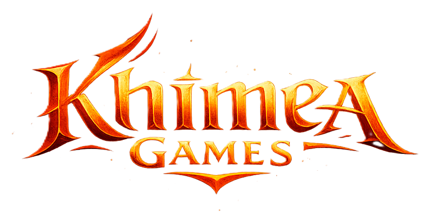
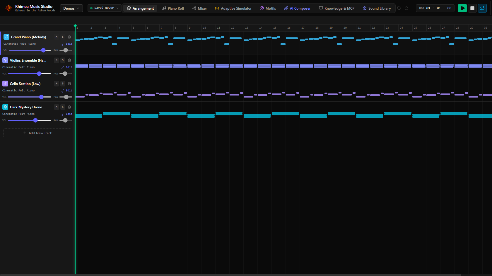
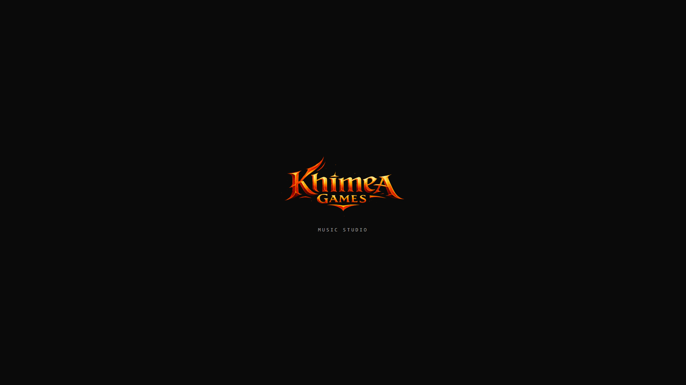

<p align="center">
  <a href="https://khimeagames.com"></a>
</p>

# Khimea Music Studio

Por [Khimea Games](https://khimeagames.com) · [khimeagames.com](https://khimeagames.com)

Estación de trabajo para componer música de videojuegos y exportarla lista para el motor: loops sin costura, stems, nivel de loudness exacto y créditos de cada sample que sonó.

Tiene dos partes:

- **Una app web** (React + Vite) para escribir, escuchar y mezclar composiciones: piano roll, arreglo, mezclador, motivos y una simulación de audio adaptativo.
- **Un servidor con API** (Express) que expone todas las operaciones de composición como herramientas tipo MCP. Por esa API la usan agentes de IA o scripts propios. La API llama a un **renderizador en Python** que suena con bibliotecas de samples reales (CC0 / CC-BY).

No genera audio con IA: cada nota la escribe alguien, una persona o un agente vía la API. El sonido sale de instrumentos sampleados y de síntesis propia.

Es de **código abierto y uso gratuito**: lo podés usar, modificar y compartir, y la música que hagas es tuya. Lo único que no se permite es vender el programa ([licencia](LICENSE)). Si lo usás en tu juego, una mención en los créditos se agradece.



---

## Qué hace

- **Composición por API**: crear composiciones, editarlas con operaciones precisas (patrones de acordes, frases, humanize, fades, transposición…), guardarlas en el servidor y compararlas. Detalle completo en [`docs/API.md`](docs/API.md).
- **Render con samples reales**: 74 instrumentos (orquesta, pianos, guitarras, instrumentos medievales, percusión, banda de rock y metal con simulador de amplificador, sintes retro, texturas de cinta y vinilo…), cada uno calibrado en nivel para que las mezclas no cambien al pasar de una biblioteca a otra.
- **Pensado para juegos**:
  - loops sin costura (la cola de la reverb se pliega sobre el principio, con chunk `smpl` que Unity y Godot leen solos);
  - stems por grupo que suman exacto la mezcla;
  - nivel a un objetivo de LUFS con limitador de pico real;
  - recorte de silencio de cola, fundidos y fragmentos para comparaciones A/B.
- **Medición**: loudness por pista, grupo y rango de compases (`measure_mix`), para balancear con números y no a oído.
- **Créditos automáticos**: cada exportación escribe un `_CREDITS.txt` con la licencia, la fuente y el sha256 de cada sample que sonó, y avisa si alguna biblioteca exige atribución.
- **Efectos de sonido** (opcional): búsqueda y exportación procesada (recorte, nivel, variaciones) desde una biblioteca de SFX propia.

## Requisitos

- **Node.js 20** o superior.
- **Python 3.10** o superior, con `numpy` y `scipy`.
- **ffmpeg** en el `PATH` (para OGG/MP3 y para leer audio).
- Las bibliotecas de samples (unos 3 GB). Son opcionales: sin ellas el renderizador usa los soundfonts General MIDI que vienen en `public/`.

## Instalación

```bash
git clone https://github.com/khimea-games/khimea-music-studio.git
cd khimea-music-studio
npm install
pip install numpy scipy
cp .env.example .env        # opcional: puerto, intérprete de Python, biblioteca de SFX
```

### Bibliotecas de samples

No vienen en el repositorio porque pesan mucho y son de terceros. Cada una se baja de su fuente oficial, con los comandos de [`sound-libraries/README.md`](sound-libraries/README.md). Todas son CC0 o CC-BY. Las CC-BY (pianos Salamander, Naked Drums, laúd) exigen crédito, y el renderizador lo indica en cada exportación.

Después de bajar o cambiar una biblioteca, recalibrá los niveles:

```bash
python scripts/calibrate_libraries.py            # todas
python scripts/calibrate_libraries.py cello harp # sólo algunas
```

## Uso

### La app

```bash
npm run dev
```

Abrí `http://localhost:3000` (o el puerto que pongas en `PORT`). Al abrir aparece un instante el logo del estudio: se saltea con un click o una tecla, y no se muestra si el sistema tiene activado "reducir movimiento".

<p align="center"></p>

Vistas:

| Vista | Para qué |
|---|---|
| Composer | Generar un borrador a partir de una descripción («combate contra un jefe orco») y pedir variaciones o un análisis musical |
| Arrangement / Piano Roll | Pistas, notas y secciones |
| Mixer | Volumen, paneo, envío a reverb y sala |
| Motifs & Palettes | Motivos y paletas de instrumentos reutilizables |
| Adaptive | Simula cómo reacciona la música a la intensidad del juego |
| Sound Library | Instrumentos disponibles y bibliotecas instaladas |
| Knowledge & MCP | Artículos de teoría y una consola para probar las herramientas de la API |

### La API

Todas las herramientas se llaman con `POST /api/mcp/call`. Las que escriben archivos o lanzan procesos (exportar, medir, guardar) sólo responden desde la misma máquina. La API no tiene autenticación, así que el servidor escucha en `127.0.0.1` por defecto. Exponerlo en la red (`HOST=0.0.0.0`) es decisión tuya.

```bash
# 1. Esqueleto guardado en el servidor
curl -s localhost:3000/api/mcp/call -H 'Content-Type: application/json' -d '{
  "toolName": "new_composition",
  "arguments": {"title": "Exploración", "bars": 16, "tempo": 72, "key": "D", "scale": "minor", "loop": true,
    "saveAs": "exploracion",
    "tracks": [{"id": "pno", "instrumentId": "felt_piano", "role": "melody"},
               {"id": "vc",  "instrumentId": "cello", "role": "harmony"}]}}'

# 2. Notas por reglas
curl -s localhost:3000/api/mcp/call -H 'Content-Type: application/json' -d '{
  "toolName": "edit_composition",
  "arguments": {"compositionId": "exploracion", "operations": [
    {"op": "add_chord_pattern", "trackId": "vc", "bars": [1, 16], "chords": ["Dm", "Bb", "Gm", "A7"],
     "pattern": [[0, -1, 4, 50]]}]}}'

# 3. Exportar un loop a -20 LUFS, con stems
curl -s localhost:3000/api/mcp/call -H 'Content-Type: application/json' -d '{
  "toolName": "export_audio",
  "arguments": {"compositionId": "exploracion", "name": "mi-juego/exploracion", "loop": true, "lufs": -20,
    "stemGroups": {"melodia": ["pno"], "armonia": ["vc"]}}}'
```

El resultado queda en `exports/mi-juego/` (`.wav`, `.ogg`, `.mp3`, `.mid`, `.json`, stems y `_CREDITS.txt`). La lista de herramientas está en `GET /api/mcp/tools`, y la referencia completa en [`docs/API.md`](docs/API.md).

### El renderizador, sin la app

El renderizador funciona solo, sobre cualquier composición en JSON:

```bash
python scripts/render_audio.py tema.json --loop --lufs -20 --json
python scripts/render_audio.py tema.json --lufs -18 --max-tail-silence 1.0 --stem-groups '{"melodia":["pno"]}' --true-peak-db -1
python scripts/render_audio.py --help
```

### Efectos de sonido (opcional)

`search_sfx` y `export_sfx` trabajan sobre una biblioteca de efectos propia: una carpeta con un `CATALOGO.tsv` (columnas `categoria`, `carpeta`, `archivo`, `extension`, `kb`, `segundos`). Su ruta va en `KHIMEA_SFX_LIBRARY`. Los efectos no vienen incluidos: cada uno usa los que tenga con licencia.

```bash
python scripts/sfx_tool.py search --query "door" --max-sec 3
python scripts/sfx_tool.py export --source "03_Foley/Doors/puerta.wav" --out exports/sfx/puerta --variations 3 --mono
```

## Desarrollo

```bash
npm run lint     # chequeo de tipos (tsc)
npm test         # tests del motor de composición
npm run build    # app (dist/) + servidor (server.js)
npm start        # sirve el build de producción
```

Estructura:

```
server.ts                    servidor Express y rutas de la API
src/core/                    motor de composición, edición, teoría, protocolo MCP, exportación MIDI
src/components/              interfaz (React)
scripts/render_audio.py      renderizador (samples reales, loops, stems, limitador, créditos)
scripts/sample_libraries.py  mapeo de instrumentos a bibliotecas y créditos de cada una
scripts/sfx_tool.py          búsqueda y exportación de efectos
sound-libraries/             bibliotecas de samples (no versionadas; ver su README)
data/compositions/           composiciones guardadas por la API
docs/API.md                  referencia de la API
```

## Licencia

Khimea Music Studio es de **código abierto y uso gratuito**, bajo la [licencia MIT con la Commons Clause](LICENSE).

- **Sí podés:** usarlo, copiarlo, modificarlo y compartir tus versiones, gratis y sin pedir permiso, para proyectos personales o comerciales.
- **Tu música es tuya:** lo que compongas y exportes con la app (audio, MIDI, stems) lo podés vender, publicar y meter en tus juegos, también comerciales.
- **No podés:** vender el programa, ni una versión modificada, ni cobrar por un producto o servicio cuyo valor venga del programa (por ejemplo, ofrecerlo pago como servicio web).
- **Al compartirlo:** conservá el archivo `LICENSE`.

Por la condición de no venta no es "open source" según la definición de la OSI, aunque el código está abierto para todos.

**Si lo usás en tu juego, una mención en los créditos se agradece** («Música hecha con Khimea Music Studio»). No es obligatoria, es de buena onda. Una estrella en el repositorio también ayuda.

## Licencias de los sonidos

El código de este repositorio y los sonidos tienen licencias distintas:

- **Bibliotecas de samples:** se bajan aparte y cada una conserva su licencia (ver [`sound-libraries/README.md`](sound-libraries/README.md)).
- **Soundfonts de `public/`:** son FluidR3 GM de Frank Wen, CC BY 3.0.

Si un render usa algo CC-BY, el crédito tiene que figurar en tu juego. El `_CREDITS.txt` de cada exportación trae el texto listo para copiar.
